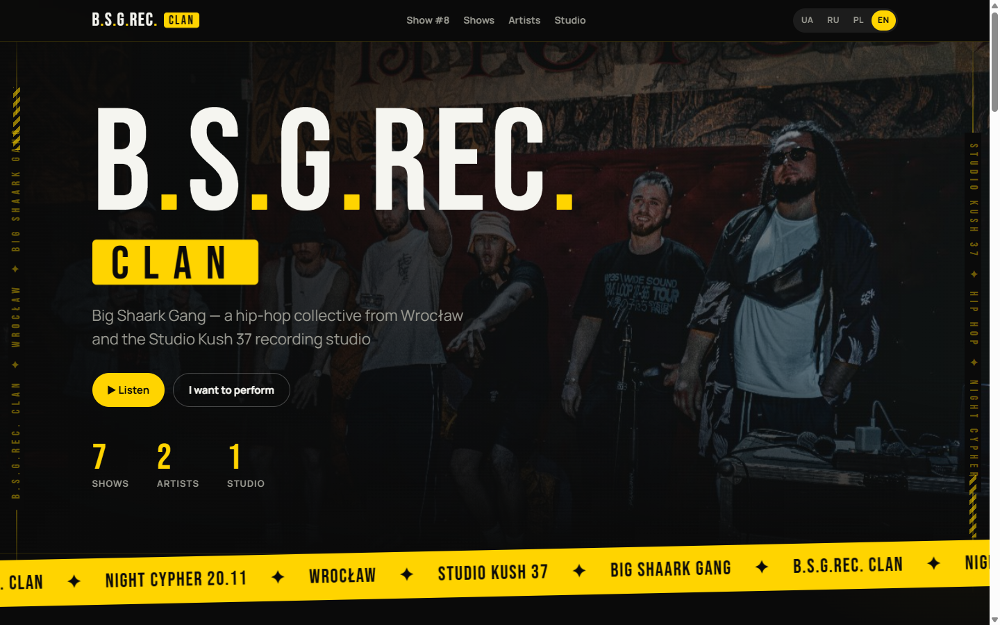
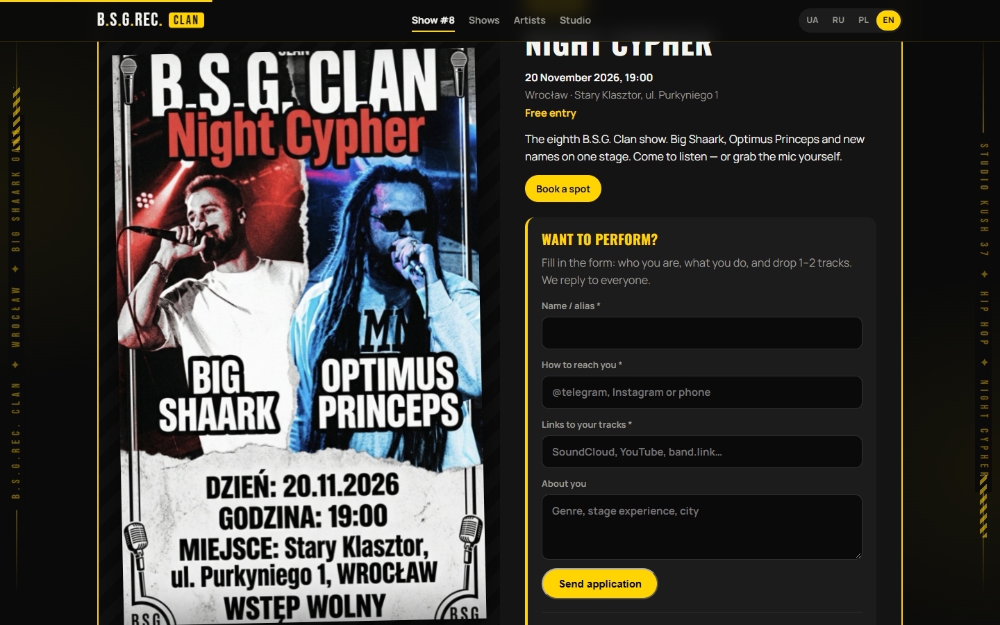
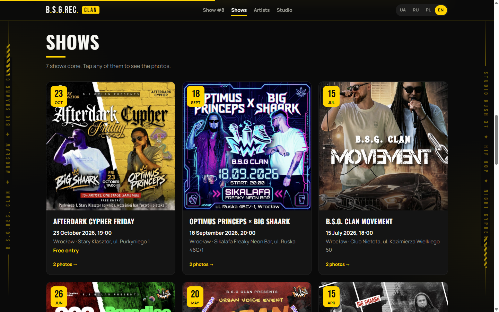
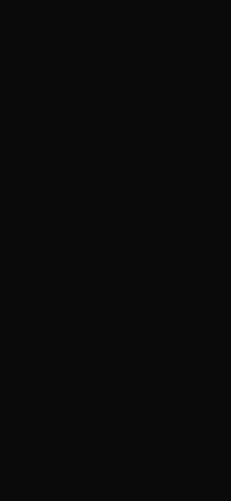
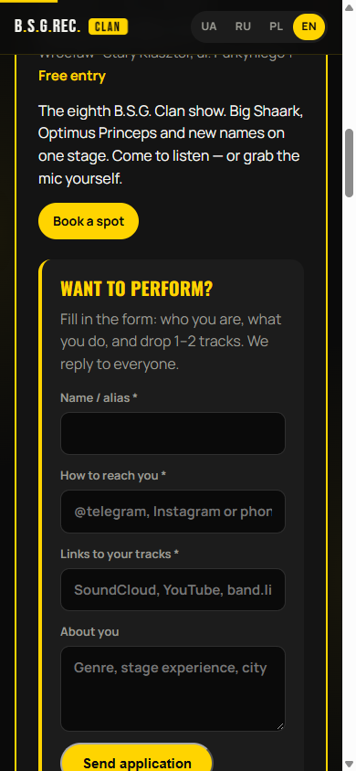
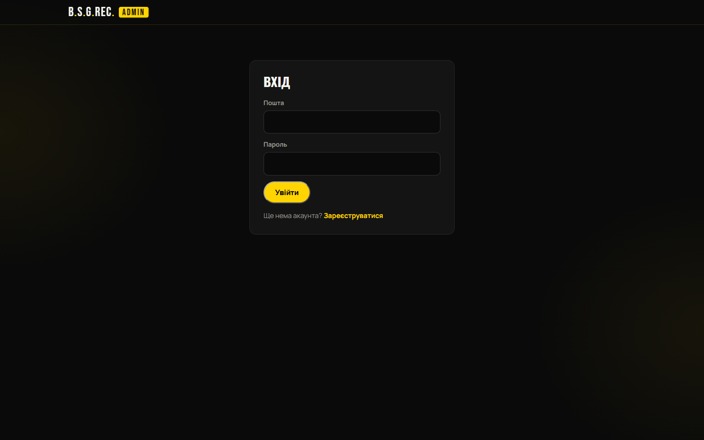

# B.S.G.REC. Clan — website, admin panel & Telegram alerts

A multilingual website for a hip-hop collective and recording studio in Wrocław, with a no-code admin panel and instant Telegram notifications for new performer applications.

**Live:** [bsgclan.com](https://bsgclan.com)



## Problem
The collective ran shows and a studio, but everything lived in Instagram posts and DMs:
- show dates, posters and photos were scattered and hard to find;
- artists who wanted to perform wrote in random chats, and requests got lost;
- every text or date change would have needed a developer.

## Solution
- **Public site** in 4 languages (UK / RU / PL / EN, auto-detected from the browser): next show, past shows with photo galleries, artists, studio.
- **"Want to perform?" form** → saved to a Postgres database → **instant Telegram message** to the organisers.
- **Admin panel** with email login and roles (owner / admin): edit shows, artists, studio texts and photos, review applications, grant or revoke admin access.

## Result
- Organisers update the site themselves — no developer needed for content changes.
- Every application lands in Telegram within seconds, with a link to the admin panel.
- Hosting costs nothing: static site on Netlify + Supabase free tier.

## How it works
```
Visitor ── form ──► Supabase (Postgres + RLS) ── trigger + pg_net ──► Telegram Bot API ──► organisers
                         ▲
Admin panel ── auth ─────┘  (roles enforced in the database, not just in the UI)
```

## Engineering highlights
- **Validation on both sides.** The same rules run in the browser and in a Row Level Security policy, so a direct API request can't bypass them.
- **Failure-safe form.** On a network error the user sees "not submitted, try again" and nothing they typed is lost (draft saved locally); offline state and timeouts are handled.
- **Spam protection.** Honeypot field + server-side length and character checks.
- **Secrets stay server-side.** The Telegram bot token and chat IDs live in Supabase Vault; the browser only has the public anon key, limited by RLS.
- **Roles in the database.** Owner / admin / user permissions are enforced by Postgres policies, so hiding a button is never the only protection.
- **No build step.** Plain HTML/CSS/JS — loads fast, easy to hand over.

## Screenshots
| Next show + application form | Past shows |
|---|---|
|  |  |

| Mobile | Mobile form | Admin login |
|---|---|---|
|  |  |  |

## Tech stack
- HTML, CSS, vanilla JavaScript
- Supabase: Postgres, Auth, Row Level Security, Storage, Vault, `pg_net`
- Telegram Bot API
- Netlify (static hosting)

## Project structure
```
site/       static website + admin panel (deploy this folder)
supabase/   SQL: schema, roles & RLS, validation, Telegram trigger
docs/       screenshots
```

## Run locally
```bash
cd site
python -m http.server 8000   # open http://localhost:8000
```
Without Supabase keys in `site/config.js`, the site runs on built-in demo data from `data.js`.

---
Built by **Roman** — AI automation & Python developer. Available for hire on Upwork.
